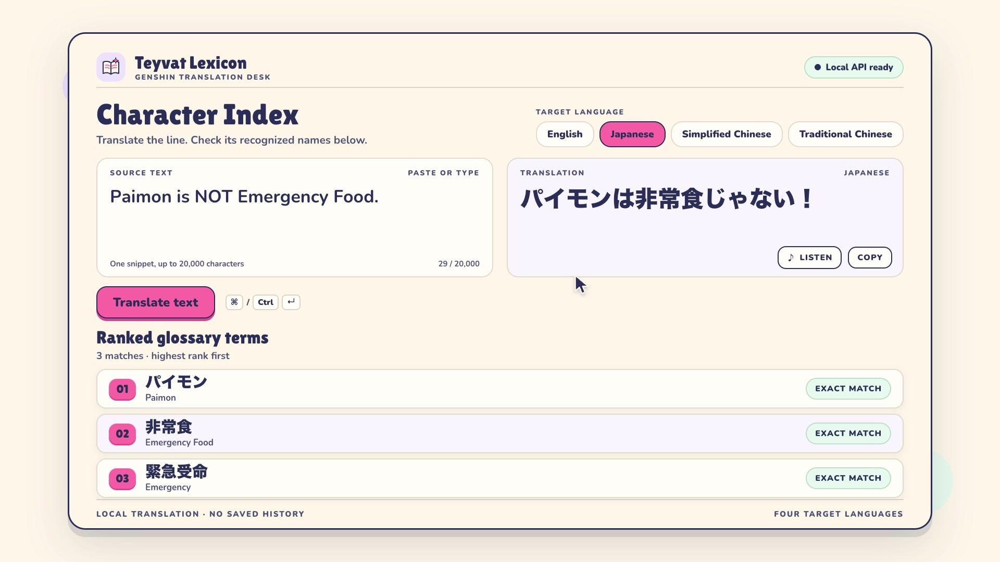

# Teyvat Lexicon

<p align="center">
  
</p>

Teyvat Lexicon is a cross-platform desktop translator for Genshin Impact snippets. It pairs a local OpenAI-compatible language model with a Genshin glossary, then shows the translation and ranked glossary matches together.

The app is built with Tauri, React, and Vite. A separate local FastAPI service handles translation, glossary retrieval, speech synthesis, and speech recognition.

<p align="center">
  
</p>
<p align="center"><em>Illustrative interface preview.</em></p>

## Features

- Translate into English, Japanese, Simplified Chinese, or Traditional Chinese.
- Use automatic source detection or tell the app that the source is Russian.
- See exact glossary matches first, with semantic matches as a fallback.
- Stream glossary matches and translated text into the desktop app as they arrive.
- Use local speech recognition to speak a snippet, and local text-to-speech to hear the translation.
- Request Japanese romaji or Chinese pinyin when needed.
- Open Quick Translate with **⌘/Ctrl + Shift + Space**. On macOS, the menu bar icon opens it too.
- Save language and display preferences and glossary favorites locally; translation history is never saved.

## Project layout

```text
.
├── api.py, main.py, model.py, pronunciation.py, speech.py, stt.py
│   └── FastAPI endpoints, translation and glossary logic, speech features
├── desktop/
│   ├── src/                 React and Vite desktop interface
│   └── src-tauri/           Tauri shell, tray integration, icons, licenses
├── docs/
│   ├── design/             Framework comparison image and source
│   └── images/              README interface preview
├── .env.example             Safe local configuration template
├── pyproject.toml, uv.lock  Python dependencies and lockfile
└── README.md, LICENSE       Project guide and MIT license
```

`data.json` and `chroma_db/` are generated local caches. The dictionary cache is downloaded and refreshed by the service; ChromaDB stores its local semantic index. They are excluded from Git and will be created as needed.

Local design-tool state and temporary launch-video renders are also excluded from Git.

## Dictionary dataset

The glossary is fetched from the [Genshin Dictionary dataset API](https://dataset.genshin-dictionary.com/words.json). Its upstream source is [`xicri/genshin-langdata`](https://github.com/xicri/genshin-langdata), the translation dataset used by the [Genshin Dictionary website](https://github.com/xicri/genshin-dictionary).

The dataset has its own [custom license and redistribution terms](https://github.com/xicri/genshin-langdata/blob/main/LICENSE.md). The MIT license in this repository covers Teyvat Lexicon's project code; it does not replace or extend the dataset's terms.

## Requirements

- Python 3.13 and [uv](https://docs.astral.sh/uv/)
- Node.js and npm (the Windows build workflow uses Node.js 22)
- Rust stable
- A local OpenAI-compatible model server with the requested model loaded
- macOS desktop development: Xcode Command Line Tools
- Windows desktop development: Microsoft C++ Build Tools and WebView2

See the [Tauri prerequisites](https://v2.tauri.app/start/prerequisites/) for platform setup details.

By default, the API expects the model server at `http://127.0.0.1:9931/v1` with model `ggml-org/gemma-4-E2B-it-GGUF:Q8_0`. Set `LLAMA_URL` and `LLAMA_MODEL` in your local `.env` file if yours differs. This app connects to a local OpenAI-compatible server; it does not need an OpenAI API key.

## Run locally

First create your local settings file:

```sh
# macOS / Linux
cp .env.example .env
```

In PowerShell on Windows, use:

```powershell
Copy-Item .env.example .env
```

Start your local model server and make sure the configured model is loaded. Then, from the repository root, install the Python dependencies and start the API:

```sh
uv sync
uv run --env-file .env uvicorn api:app --host 127.0.0.1 --port 8000
```

In a second terminal, start the desktop app:

```sh
cd desktop
npm ci
npm run tauri dev
```

The local API documentation is available at `http://127.0.0.1:8000/docs`.

## Build the desktop app

On macOS, from the `desktop/` directory, build the app bundle with:

```sh
npm run tauri build -- --bundles app
```

The bundle is written to `desktop/src-tauri/target/release/bundle/macos/Teyvat Lexicon.app`.

For Windows, the manual GitHub Actions workflow at `.github/workflows/windows-build.yml` builds a Windows x64 NSIS installer. Push the repository to GitHub, open **Actions → Build Windows app**, choose **Run workflow**, then download the `teyvat-lexicon-windows-x64` artifact from the completed run.

The Windows installer contains the Tauri desktop app. The FastAPI service and local model server must also be set up on that Windows computer.

## Local services and first-use downloads

The app's **Local API** indicator reports whether FastAPI and the configured translation model are ready. The API listens only on `127.0.0.1` by default.

Speech recognition uses the local Whisper `base` model. Text-to-speech uses Kokoro-82M. Their model files are downloaded on first use and cached on the computer. The semantic BGE-M3 model is loaded only when semantic glossary lookup is needed. These model downloads are separate from the desktop installer.

Audio is sent only to the local FastAPI service for processing and is not saved. Source text, translations, and translation history are not saved. Language preferences and glossary favorites are stored locally by the desktop app.

## API overview

| Endpoint | Purpose |
| --- | --- |
| `GET /api/v1/health` | API, dictionary, and model-server status |
| `GET /api/v1/languages` | Supported target languages |
| `POST /api/v1/translations` | Translate text and return ranked glossary terms |
| `POST /api/v1/translations/stream` | Stream terms and translation as newline-delimited JSON events |
| `POST /api/v1/speech` | Synthesize translated text as an in-memory WAV response |
| `POST /api/v1/pronunciations` | Return romaji or pinyin on request |
| `POST /api/v1/transcriptions?source_language=auto or ru` | Transcribe a short audio clip locally |

Example:

```sh
curl -X POST http://127.0.0.1:8000/api/v1/translations \
  -H 'Content-Type: application/json' \
  -d '{"text":"Hello!","target_language":"ja"}'
```

Exact phrase matches rank first. If none are found, semantic candidates are ranked by ChromaDB's raw distance score; lower distances are closer and are not probabilities. Requests accept up to 20,000 characters. Supported target codes are `en`, `ja`, `zhCN`, and `zhTW`; Russian is a supported source language, not a target language.

## License

The project is released under the MIT License; see [LICENSE](LICENSE). Third-party libraries, fonts, icons, dictionary data, and downloaded model weights may have separate terms. Bundled desktop asset notices are in `desktop/src-tauri/licenses/`.
